# Derivation of Lüscher's formula

## $\delta$-function interaction

The contact interaction is regulated by a hard cutoff $\Lambda$,

$$
\langle \vec p\,' | \hat V_\delta | \vec p \rangle = \frac{4\pi a(\Lambda)}{m}\,\theta(\Lambda - p')\,\theta(\Lambda - p) \, ,
$$

where $a(\Lambda)$ is tuned to reproduce the T-matrix at threshold,

$$
a(\Lambda) = \frac{a_0}{1 - \tfrac{2}{\pi} a_0 \Lambda} \, ,
$$

and $a_0$ is the physical s-wave scattering length.

## Scattering amplitude in free space

:::{.columns}

:::{.column width="60%"}
Because this interaction is separable, the bubble sum can be summed geometrically to give

:::{style='font-size:80%'}
$$
\begin{aligned}
T(\vec p, -\vec p; E)
&= \frac{4\pi a(\Lambda)/m}{1 - \tfrac{4\pi a(\Lambda)}{m}\int\! \tfrac{d^3 q}{(2\pi)^3}\, \tfrac{1}{E - q^2/m + i\varepsilon}} \\[4pt]
&= \frac{4\pi a(\Lambda)/m}{1 - \tfrac{2 a(\Lambda)}{\pi}\int\! dq\, \tfrac{q^2}{mE - q^2 + i\varepsilon}} \\[4pt]
&= \frac{4\pi/m}{\tfrac{1}{a(\Lambda)} - \tfrac{2}{\pi}\int_0^\Lambda\! dq \left(\mathcal{P}\tfrac{q^2}{mE - q^2} - i\pi q^2 \delta(mE - q^2)\right)}
\end{aligned}
$$

:::

:::

:::{.column width="40%"}

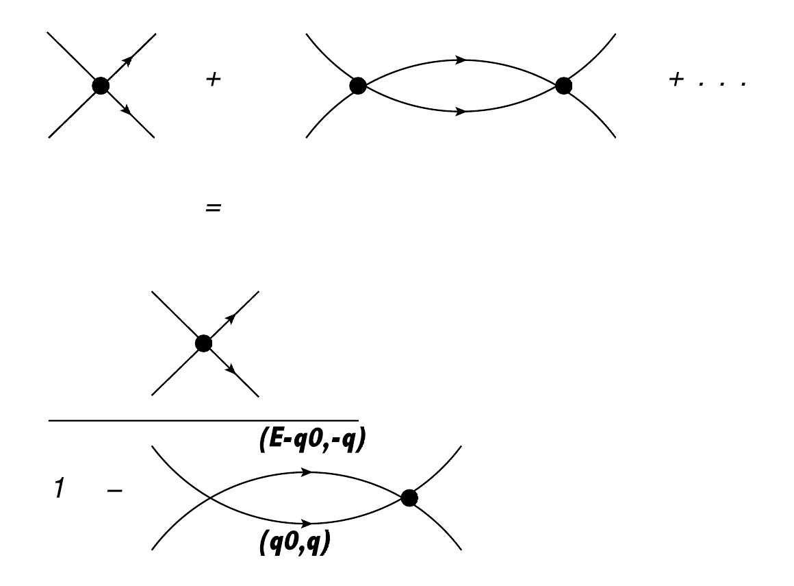{fig-align="center" width="100%"}

:::{style='font-size:80%'}
The bubble sum using the contact interaction.
:::

:::

:::

---

### Evaluating the denominator

:::{style='font-size:80%'}
$$
\begin{aligned}
\frac{1}{a(\Lambda)} &- \frac{2}{\pi}\int_0^\Lambda\! dq \left(\mathcal{P}\tfrac{q^2}{mE - q^2} - i\pi q^2 \delta(mE - q^2)\right) \\[4pt]
&= \frac{1}{a(\Lambda)} + \frac{2}{\pi}\left(\Lambda - \tfrac{\sqrt{mE}}{2}\log\Big(\tfrac{\Lambda + \sqrt{mE}}{\Lambda - \sqrt{mE}}\Big) + i\tfrac{\pi}{2}\sqrt{mE}\right) \\[4pt]
&= \frac{1}{a_0} - \frac{\sqrt{mE}}{\pi}\log\Big(\tfrac{\Lambda + \sqrt{mE}}{\Lambda - \sqrt{mE}}\Big) + i\sqrt{mE} \, .
\end{aligned}
$$
:::

### Resulting amplitude

:::{style='font-size:80%'}

Plugging this back in gives

$$
\begin{aligned}
T(\vec p, -\vec p; E)
&= \frac{4\pi/m}{\tfrac{1}{a_0} - \tfrac{\sqrt{mE}}{\pi}\log\Big(\tfrac{\Lambda + \sqrt{mE}}{\Lambda - \sqrt{mE}}\Big) + i\sqrt{mE}} \\[4pt]
&\approx \frac{4\pi/m}{\tfrac{1}{a_0} + i\sqrt{mE} - \tfrac{2mE}{\pi}\tfrac{1}{\Lambda} + O(\Lambda^{-2})} \, .
\end{aligned}
$$

+ At threshold one recovers the correct normalization, $T(\vec 0, \vec 0; E=0) = 4\pi a_0/m$.  

+ Assuming the existence of a bound state $E=-B$, one gets the familiar result from the pole of the amplitude:  $B=\frac{1}{ma_0^2}$.

:::

## Lüscher's formula

Within a finite cubic volume of size $L^3$, the analog of the denominator evaluated above is

$$
\begin{aligned}
\frac{1}{a(\Lambda)} - \frac{4\pi}{m}\frac{1}{L^3}\sum_{\vec n}^{2\pi n < \Lambda L}\frac{1}{E - \tfrac{4\pi^2 n^2}{m L^2}}
&= \frac{1}{a(\Lambda)} - \frac{1}{\pi}\frac{1}{L}\sum_{\vec n}^{2\pi n < \Lambda L}\frac{1}{\epsilon - n^2} \\[4pt]
&= \frac{1}{a_0} - \frac{2}{\pi}\Lambda - \frac{1}{\pi}\frac{1}{L}\sum_{\vec n}^{2\pi n < \Lambda L}\frac{1}{\epsilon - n^2} \, ,
\end{aligned}
$$

where I define $\epsilon = \dfrac{E m L^2}{4\pi^2}$.

## Lüscher's formula (cont.)

$\Lambda$ above has dimension of inverse length. Moving to a dimensionless definition of $\Lambda$,

$$
\Lambda \to \frac{2\pi}{L} \Lambda\, ,
$$

we now have^[The limit $\Lambda \to \infty$ is tacitly assumed, but sometimes I write it explicitly.]

$$
\frac{1}{a_0} - 4\frac{\Lambda}{L} - \frac{1}{\pi}\frac{1}{L}\sum_{\vec n}^{n < \Lambda}\frac{1}{\epsilon - n^2}
= \frac{1}{a_0} - \frac{1}{\pi L}\left(\sum_{\vec n}^{n < \Lambda}\frac{1}{\epsilon - n^2} + 4\pi\Lambda\right) \, ,
$$

which we can rewrite as

$$
-\frac{1}{a_0}=\frac{1}{\pi L}\lim_{\Lambda \to \infty}\left(\sum_{\vec n}^{n < \Lambda}\frac{1}{n^2-\epsilon} - 4\pi\Lambda\right)\equiv \frac{1}{\pi L}S_0\left(\epsilon\right)
$${#eq-contact-luescher}

and the RHS is now Lüscher's formula. In particular, values of $\epsilon$ that satisfy this equality correspond to the eigen-energies of the two-particle interacting system.

## Interpretation: $-\frac{L}{a_0}=\frac{1}{\pi}S_0\left(\epsilon\right)$

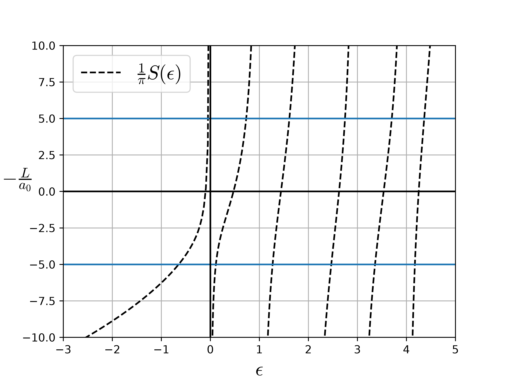{fig-align="center" width="100%"}

:::{style='font-size:80%'}
+ Given horizontal line $-L/a_0$, the allowed quantized energies $\epsilon$ occur at the intersection of line with the dashed curves
:::

## The full expression
:::{style='font-size:80%'}
To obtain the full *model-independent* Lüscher formula, the idea is to generalize the potential

$$
\langle \vec p\,' | \hat V | \vec p \rangle = \theta(\Lambda - p')\left(C_0(\Lambda)+C_2(\Lambda)\frac{p'^2+p^2}{2}+\ldots\right)\theta(\Lambda - p) \, ,
$$

where the coefficients $C_i(\Lambda)$ are tuned such that the scattering amplitude gives the correct physical phase shift $\delta$,

$$
T(\vec p,-\vec p;E) = -\frac{4\pi}{m}\frac{1}{p\cot\delta - ip}
$${#eq-matching}

When we repeat the calculation in a finite volume with this potential, it leads to the full Lüscher formula

$$
p\cot\delta = \frac{1}{\pi L}S_0(\epsilon)\ .
$$
where $\epsilon$ is defined as before.

:::{.callout-note}

For detailed derivations see

+ [Two Nucleons on a Lattice](https://arxiv.org/abs/hep-lat/0312004) by S.R. Beane, P.F.Bedaque, A. Parreno, M.J. Savage 
+ [Fitting two nucleons inside a box](https://arxiv.org/abs/hep-lat/0702021) by Paulo F. Bedaque, Ikuro Sato

and of course the original sources by Lüscher (***Warning!!  Hard to understand!!***)

+ [Commun.Math.Phys. 104 (1986) 177](https://link.springer.com/article/10.1007/BF01211589) & [Commun.Math.Phys. 105 (1986) 153-188](https://link.springer.com/article/10.1007/BF01211097)

:::

:::

# Lüscher's formula in action

## Toy Model

I assume a Hamiltonian with potential of the form

$$
\langle \vec p' | \hat V | \vec p \rangle = V(p',p) = \frac{2\pi C_0}{\mu} f(p') f(p)
$$
$$
f(p) = \exp\left(-\frac{\pi (p r)^2}{32}\right)
$$
$$
C_0^{-1} = \frac{1}{a_0} - \frac{4}{\pi r} \, ,
$$

This is a separable potential with parameters chosen such that

$$
p \cot\delta(p) = \frac{1}{f(p)^2}\left(-\frac{1}{a_0} + \frac{2p}{\sqrt\pi} F\!\left(\tfrac{1}{4} p \sqrt\pi r\right)\right) \approx -\frac{1}{a_0} + \frac{r}{2} p^2 - \frac{r^3}{48} p^4 + \mathcal{O}(p^6)
$$

##

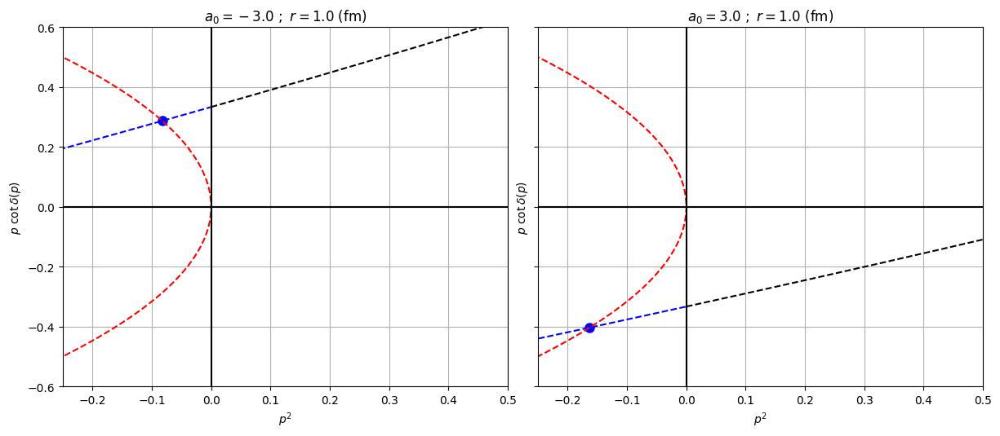{fig-align="center" width="95%"}

## Procedure when particles are put in a box

In a box of side length $L$, the eigenenergies $E$ can be obtained by solving the following transcendental equation

$$
-\frac{L}{a_0} + \frac{4L}{\pi r} = \frac{1}{\pi} \sum_{\vec n \in \text{B.Z.}} \frac{f(\vec n)^2}{\vec n^2 - \epsilon} \, ,
$$

with $\epsilon = \dfrac{E mL^2}{4\pi^2}$ and $f(\vec n) = \exp\left(-\dfrac{\pi^3 r^2}{8 L^2} \vec n^2\right)$. I assume the two particles have equal mass $m$.

Given $\epsilon$, I insert this into Lüscher's formula to get the phase shift

$$
p\cot\delta(p) = \frac{1}{\pi L} S_0(\epsilon)
$$

where

$$
S_0(\epsilon) = \lim_{\Lambda \to \infty} \left[ \sum_{\vec n}^{n < \Lambda} \frac{1}{n^2 - \epsilon} - 4\pi\Lambda \right]
$$

## "deuteron" in a box

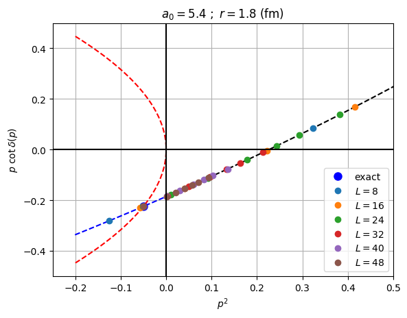{fig-align="center" width="70%"}

## Closer look at the "deuteron" case

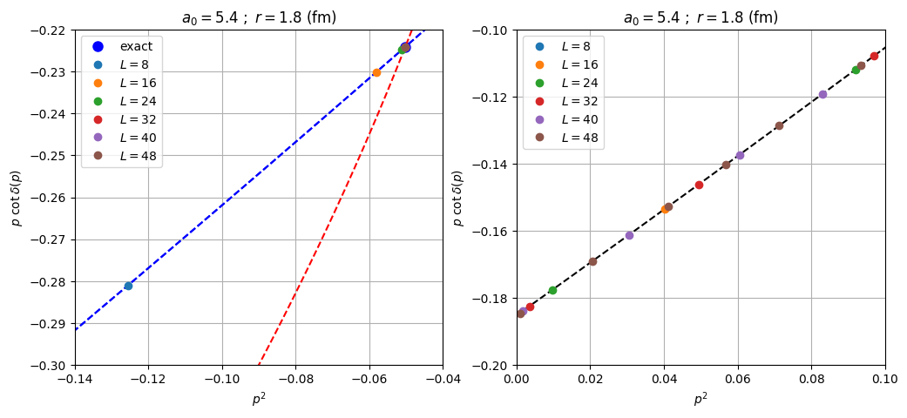{fig-align="center" width="100%"}

## Finite volume dependence of the bound state

:::: {.columns}
::: {.column width="50%"}
Can be shown that the location of the bound state depends exponentially on $L$

$$
E_{-1}(L) = -\frac{\gamma^2}{m}\left(1 + \tfrac{12}{\gamma L}\, \tfrac{e^{-\gamma L}}{1 - 2\gamma(p\cot\delta)'} + \dots \right)
$$
$$
\approx -\frac{\gamma^2}{m}\left(1 + \tfrac{12}{\gamma L}\, \tfrac{e^{-\gamma L}}{1 - \gamma r} \right)
$$

Here I define $p = i\gamma$
:::
::: {.column width="50%"}
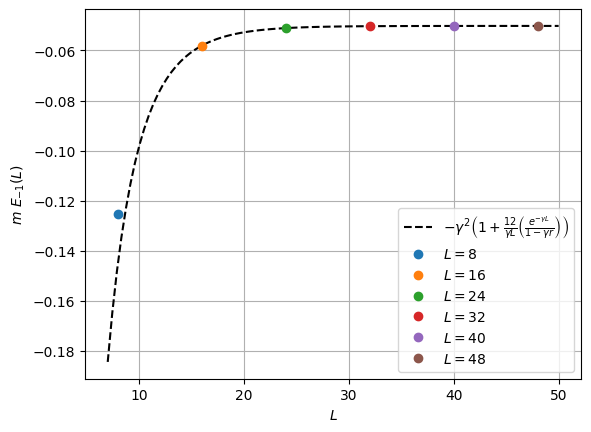{fig-align="center" width="100%"}
:::
::::

:::{.callout-note}
+ See [Two Nucleons on a Lattice](https://arxiv.org/abs/hep-lat/0312004) by S.R. Beane, P.F.Bedaque, A. Parreno, M.J. Savage  
:::

## Finite volume dependence of lowest scattering state

:::{.style='font-size:80%'}
:::{.columns}

:::{.column width=50%}
Lowest scattering state has polynomial dependence on $L$:

$$
\scriptsize
\begin{aligned}
E_0(L) = \frac{4\pi a_0}{m L^3}\Big(&1 + 2.8372974794806\,\tfrac{a_0}{L}\\
&+ 6.375183165675\left(\tfrac{a_0}{L}\right)^2 \\
&+ 8.311950724058\left(\tfrac{a_0}{L}\right)^3 + 2\pi\,\tfrac{a_0^2 r}{L^3} + \dots\Big)
\end{aligned}
$$

Note: $m E_0 = p^2$
:::

:::{.column width=50%}
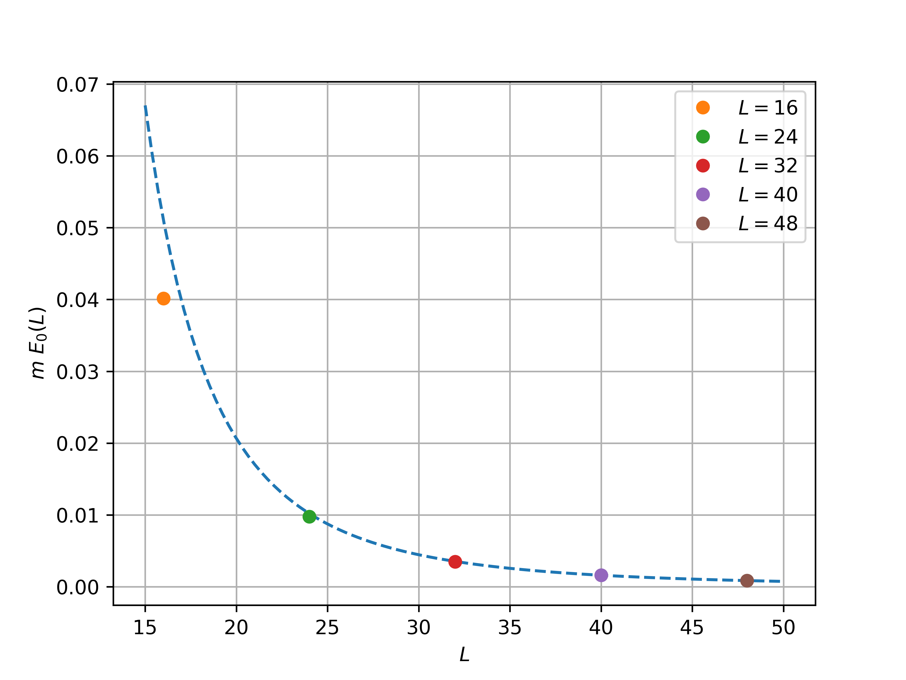{fig-align="center" width="100%"}

:::
:::

:::{.callout-note}
+ See [$n$-Boson Energies at Finite Volume and Three-Boson Interactions](https://arxiv.org/pdf/0707.1670) by S.R. Beane, W. Detmold, M.J. Savage  
:::
:::

## Now let's consider a virtual state situation

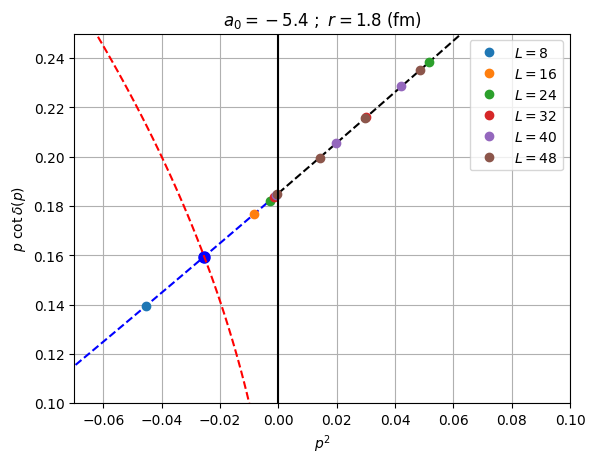{fig-align="center" width="75%"}

## Zooming in again. . .

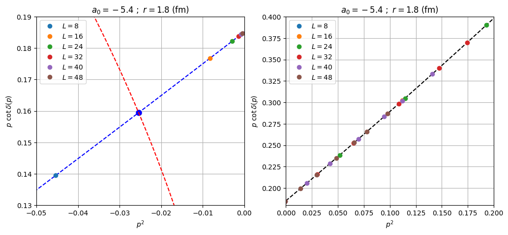{fig-align="center" width="100%"}

## Virtual state has same finite volume dependence as a scattering state

:::{.style='font-size:80%'}

:::{.columns}

:::{.column width=50%}
Virtual state has polynomial dependence on $L$ just like a regular scattering state:

$$
\scriptsize
\begin{aligned}
E_0(L) = \frac{4\pi a_0}{m L^3}\Big(&1 + 2.8372974794806\,\tfrac{a_0}{L} \\
&+ 6.375183165675\left(\tfrac{a_0}{L}\right)^2 \\
&+ 8.311950724058\left(\tfrac{a_0}{L}\right)^3 + 2\pi\,\tfrac{a_0^2 r}{L^3} + \dots\Big)
\end{aligned}
$$
:::

:::{.column width=50%}

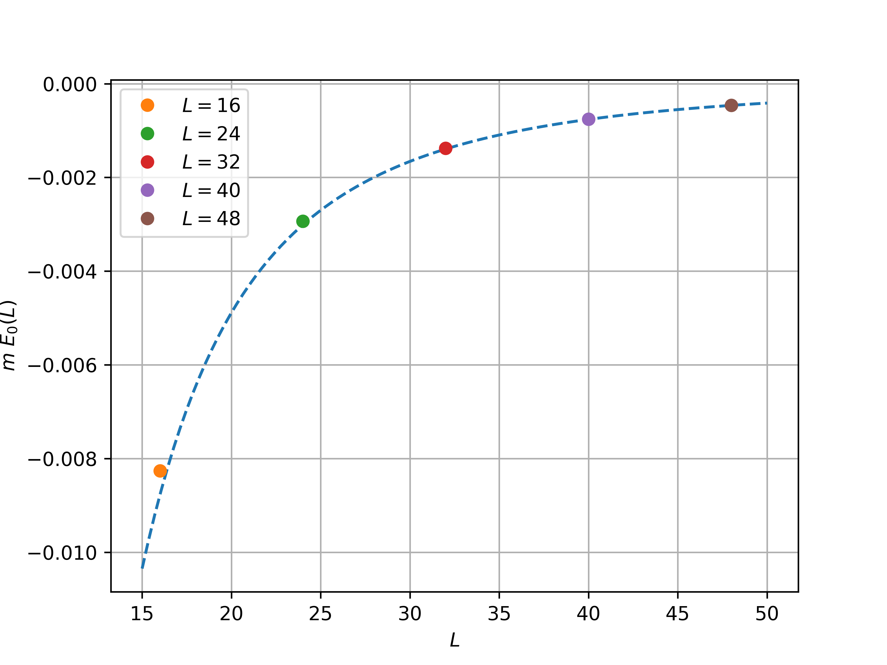{fig-align="center" width="100%"}

:::
:::
:::

## And now a repulsive state

:::: {.columns}
::: {.column width="50%"}

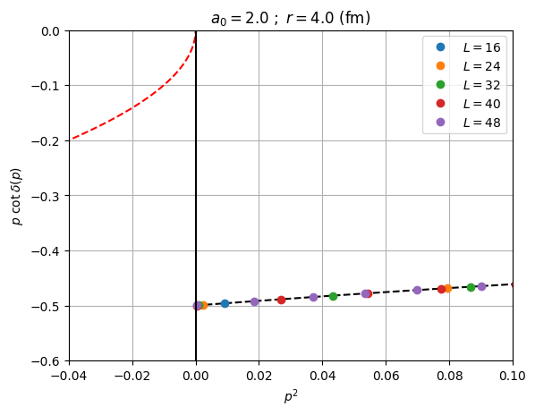{fig-align="center" width="100%"}

:::
::: {.column width="50%"}

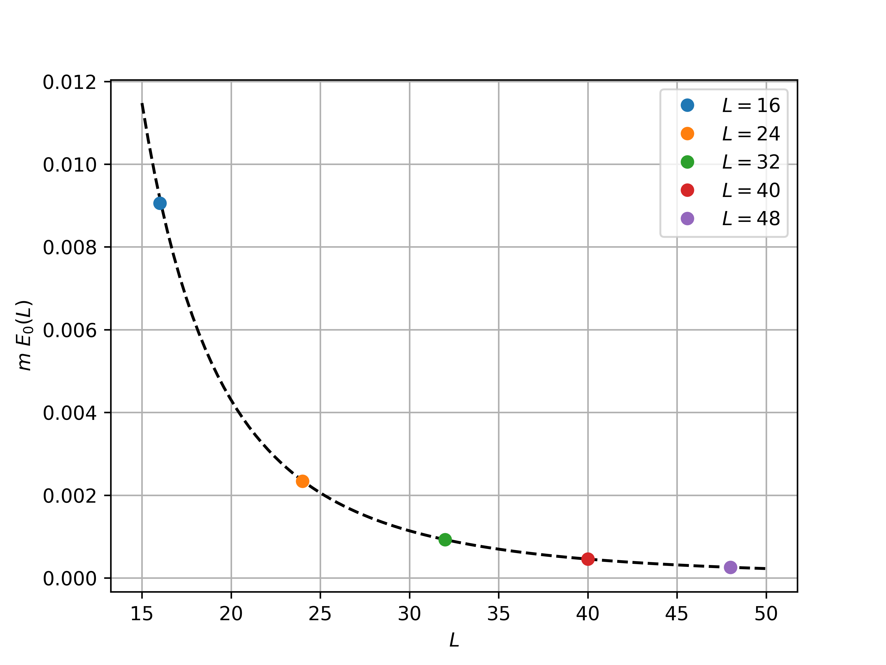{fig-align="center" width="100%"}

:::{.r-stack}
Finite-volume dependence of lowest scattering state
:::
:::
::::

## When does Lüscher's formula fail?

+ Lüscher's formula is derived assuming only short-ranged interactions ($\ll L$)
  - This results in power-law corrections ($1/L$) to on-shell scattering
  - Exponential corrections to bound states
+ $t$-channel exchange via one-pion exchange (long range, near on-shell) introduces a left-hand cut (lhc)
  - $DD^*$ scattering example:
$$
\big(p^{1\pi}_{\rm lhc}\big)^2 = -\frac{\mu^2}{4}, \qquad \mu^2 = m_\pi^2 - \Delta M^2, \qquad \Delta M = M_{D^*}-M_D
$$
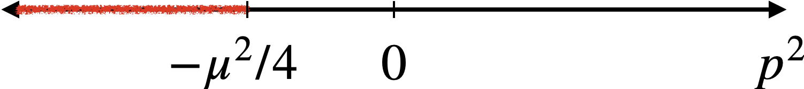{fig-align="center"}
+ When $m_\pi^2\sim \Delta M^2$ then lhc is near threshold and ERE breakes down$\implies$ Lüscher's formula no longer applicable

## Current strategies to deal with left-hand cuts

+ Keep the OPE explicit and apply Lüscher only to the short-range remainder
  + *Lüscher equation with long-range forces* [2402.12985](https://arxiv.org/abs/2402.12985)

+ Go full three-body, treating the pion as dynamical since it goes on-shell
  + *Incorporating $DD\pi$ effects and left-hand cuts in lattice QCD studies of the $T_{cc}(3875)^+$* [2401.06609](https://arxiv.org/abs/2401.06609)

+ Extend the formalism onto the cut itself
  + *Finite-volume scattering on the left-hand cut* [2311.18793](https://arxiv.org/abs/2311.18793)

+ Solve a finite-volume Schrödinger equation in a plane-wave basis with chiral EFT potentials, using half-off-shell potentials that stay analytic below threshold and dodging partial-wave truncation
  + *Left-hand cut problem in lattice QCD and an EFT-based solution* [2503.23944](https://arxiv.org/abs/2503.23944)

## Can we use separable potentials to include left-hand cuts?

:::{style='font-size:70%'}

+ I will only consider s-wave scattering to keep life as simple as possible.

+ The "long-range" part is modeled by one-pion exchange (OPE)^[$\mu\sim m_\pi$ is the pion mass and $g$ is the dimensionless pion coupling constant ($g=\frac{g_A\mu}{2f_\pi}$).]

$$
V^{l=0}_{\pi}(p',p) = -\frac{g^2}{4p'p}\log\left(\frac{(p+p')^2+\mu^2}{(p-p')^2+\mu^2}\right)
$$

+ The branch cut can be seen by setting $p' = p$ and noting that the log's argument becomes negative for 

$$p^2 < -\mu^2/4$$

+ Assuming there is a way to do this, I want to expand this long-range potential in a separable basis, i.e.

$$
V^{l=0}_{\pi}(p',p) = \sum_{i,j}^{\infty} g_i(p') \lambda_{ij} g_j(p)\approx \sum_{i,j}^{N} g_i(p') \lambda_{ij} g_j(p)
$$

+ The question is then: what is a good choice of basis functions $g_i(p)$ (or *form factors*) that can reproduce the branch cut?

  - Typically, one would use a polynomial basis that is analytic in the complex plane (i.e. "entire"), but this will not reproduce the branch cut.

:::

## $V_{\rm cut}(p',p)$: a separable potential that reproduces (most of) the branch cut

:::{style='font-size:70%'}

+ So here's an idea: Consider the following expression:

$$
V_{\rm cut}(p',p)\equiv-\frac{g^2}{2\mu^2}\left[h(p')+h(p)\right]
$$
where
$$
h(p) = \frac{\mu^2}{4p^2} \log\left(\frac{4 p^2+\mu^2}{\mu^2}\right)
$$

:::{.columns}

:::{.column width="50%"}

:::{.callout-note}
## Properties of $V_{\rm cut}(p',p)$

  - $V_{\rm cut}(p'=p)$ has the same *on-shell* branch cut structure as $V^{l=0}_{\pi}(p'=p)$
  - symmetric in $p$ and $p'$
  - it is separable
:::

:::

:::{.column width="50%"}

:::{.callout-warning}
 - $V_{\rm cut}(p',p)$ does not reproduce the correct full *off-shell* singularity structure!!!
:::

:::

:::

+ So the idea is to use the following expression:

$$
V^{l=0}_{\pi}(p',p) = V_{\rm cut}(p',p) + \underbrace{V^{l=0}_{\pi}(p',p)-V_{\rm cut}(p',p)}_{\approx\sum_{i,j=2}^{N} g_i(p') \lambda_{ij} g_j(p)}
$$

+ The functions $g_i(p)$ are analytic in the complex plane

:::

## Let's add this potential to the $\delta$-term from before

:::{style='font-size:80%'}

\begin{align}
\hat V &= \hat V^{l=0}_\pi + \hat V_\delta \nonumber\\
&= \hat V_{\rm cut} + ( \hat V^{l=0}_\pi - \hat V_{\rm cut} ) + \hat V_\delta \nonumber\\
&= -\frac{g^2}{2\mu^2}\left[\hat h \hat\delta_\Lambda+ \hat\delta_\Lambda\hat h\right] + \sum_{i,j=2}^{N} \hat g_i \hat\delta_\Lambda \lambda_{ij}\hat g_j + \frac{4\pi a(\Lambda)}{m} \hat\delta_\Lambda\nonumber
\end{align}
:::

where $\hat\delta_\Lambda$ is the regulated delta function defined as $\langle p'| \hat\delta_\Lambda|p\rangle=\theta(\Lambda - p')\,\theta(\Lambda - p)$, and $\hat h$ and $\hat g_i$ are operators defined such that $\hat h|p\rangle = h(p)|p\rangle$ and $\hat g_i|p\rangle = g_i(p)|p\rangle$.

I can rexpress this potential in rank-$(N+1)$ form.  I first define the vector of form factors $\hat{\bf f} = (1,\hat h,\hat g_2,\ldots,\hat g_N)$.  The potential is then $\hat V = \hat{\bf f}^T {\hat\lambda} \hat{\bf f}$, where $\lambda$ is

:::{style='font-size:70%'}
$$
{\hat \lambda} = \begin{pmatrix}
\frac{4\pi a(\Lambda)}{m} & -\frac{g^2}{2\mu^2} & 0 & \cdots & 0 \\
-\frac{g^2}{2\mu^2} & 0 & 0 & \cdots & 0 \\
0 & 0 & \lambda_{22} & \cdots & \lambda_{2N} \\
\vdots & \vdots & \vdots & \ddots & \vdots \\
0 & 0 & \lambda_{N2} & \cdots & \lambda_{NN}
\end{pmatrix}\  \hat\delta_\Lambda \, .
$$
:::

---

### Now consider the $T$-matrix

$$
\hat T(E)=\hat V + \hat V \hat G_0(E) \hat T(E)
$$

Assume

$$
\hat T(E) = \hat{\bf f}^T \tau(E) \hat{\bf f}
$$

and the beauty of separability comes into play:

$$
\tau^{-1}(E) = 
\begin{cases}
\lambda^{-1} - \frac{1}{(2\pi)^3}\int^\Lambda d^3pf(p) G_0 (p;E) f^T(p) & {\rm \infty\  volume}\\
\lambda^{-1} - \frac{1}{L^3}\sum_n^\Lambda f(p_n) G_0 (p_n;E) f^T(p_n) & {\rm finite\  volume}
\end{cases}
$$

<!-- 
## Quantization condition

:::{.callout-important}
## Quantization condition
$$
\begin{align}
\det\left[\lambda^{-1} - \frac{1}{L^3}\sum_n^\Lambda f(p_n) G_0(p_n;E) f^T(p_n)\right] &= 
\det\left[\lambda^{-1} - \frac{1}{L^3}\sum_n^\Lambda f\left(\frac{2\pi |n|}{L}\right) \frac{1}{E - \frac{4\pi^2 n^2}{mL^2} } f^T\left(\frac{2\pi |n|}{L}\right)\right]\nonumber\\
&=\det\left[\lambda^{-1} +\frac{m}{4\pi^2 L}\sum_n^\Lambda f\left(\frac{2\pi |n|}{L}\right) \frac{1}{n^2-\epsilon} f^T\left(\frac{2\pi |n|}{L}\right)\right]\nonumber
= 0
\end{align}
$$
:::

:::{style='font-size:80%'}
This expression recovers the contact Lüscher formula @eq-contact-luescher in the limit $N\to 1$, $h\to0$, and $g_i\to 0\ \forall\  i$.
::: 
-->

## Test case: $N=2$

This is equivalent to setting $g_i(p)=0\  \forall\ i \implies f(p) = (1,h(p))$.  We thus have

$$
\lambda = \begin{pmatrix}
\frac{4\pi a(\Lambda)}{m} & -\frac{g^2}{2\mu^2} \\
-\frac{g^2}{2\mu^2} & 0
\end{pmatrix}
\implies
\lambda^{-1} = \begin{pmatrix}
0 & -\frac{2\mu^2}{g^2} \\
-\frac{2\mu^2}{g^2} & -\frac{4\mu^4}{g^4}\frac{4\pi a(\Lambda)}{m}
\end{pmatrix}
$$

#### Re-tuning $a(\Lambda)$

We have to retune $a(\Lambda)$ to give the correct scattering amplitude at threshold in the continuum.  Note that $V_{\rm cut}$ is also linearly divergent.  This  complicates things, as we will see.  

So the condition I want to match is

:::{style='font-size:80%'}
$$
T(p'=p=0;E=0)=\frac{4\pi a_0}{m}={\bf f}^T(0)\tau(0){\bf f}(0)=\tau_{11}(0)+\tau_{12}(0)+\tau_{21}(0)+\tau_{22}(0)
$$
:::

---

We have then that

:::{style='font-size:70%'}
$$
\begin{align}
\tau^{-1}(0)&=
\underbrace{
\begin{pmatrix}
0 & -\frac{2\mu^2}{g^2} \\
-\frac{2\mu^2}{g^2} & -\frac{4\mu^4}{g^4}\frac{4\pi a(\Lambda)}{m}
\end{pmatrix}}_{\lambda^{-1}}
-
\underbrace{
\int^\Lambda \frac{d^3p}{(2\pi)^3}
\begin{pmatrix}
\frac{-1}{p^2/m} & -\left(\frac{\mu}{2p}\right)^2\frac{\log\left(1+\frac{4p^2}{\mu^2}\right)}{p^2/m}\\
-\left(\frac{\mu}{2p}\right)^2\frac{\log\left(1+\frac{4p^2}{\mu^2}\right)}{p^2/m} & -\left(\frac{\mu}{2p}\right)^4\frac{\log^2\left(1+\frac{4p^2}{\mu^2}\right)}{p^2/m}
\end{pmatrix}}_{\frac{1}{(2\pi)^3}\int^\Lambda d^3pf(p) G_0 (p;E=0) f^T(p)}\nonumber\\
&=
\begin{pmatrix}
0 & -\frac{2\mu^2}{g^2} \\
-\frac{2\mu^2}{g^2} & -\frac{4\mu^4}{g^4}\frac{4\pi a(\Lambda)}{m}
\end{pmatrix}+
\frac{m}{2\pi^2}\int^\Lambda dp
\begin{pmatrix}
1 & \left(\frac{\mu}{2}\right)^2\frac{\log\left(1+\frac{4p^2}{\mu^2}\right)}{p^2}\\
\left(\frac{\mu}{2}\right)^2\frac{\log\left(1+\frac{4p^2}{\mu^2}\right)}{p^2} & \left(\frac{\mu}{2}\right)^4\frac{\log^2\left(1+\frac{4p^2}{\mu^2}\right)}{p^4}
\end{pmatrix}\nonumber\\
&=
\begin{pmatrix}
0 & -\frac{2\mu^2}{g^2} \\
-\frac{2\mu^2}{g^2} & -\frac{4\mu^4}{g^4}\frac{4\pi a(\Lambda)}{m}
\end{pmatrix}+
\frac{m}{2\pi^2}
\begin{pmatrix}
\Lambda & \frac{\pi  \mu }{2}-\Delta_1(\Lambda)\\
\frac{\pi  \mu }{2}-\Delta_1(\Lambda)& \frac{2 \pi  \mu }{3}(1-\log (2))-\Delta_2(\Lambda)
\end{pmatrix}\nonumber
\end{align}
$$

:::

where

:::{style='font-size:60%'}
$$
\begin{align}
\Delta_1(\Lambda)&=\frac{\mu ^2 \log \left(\frac{4 \Lambda ^2}{\mu ^2}+1\right)}{4 \Lambda }+\mu  \cot ^{-1}\left(\frac{2 \Lambda }{\mu }\right)\sim\mathcal{O}\left(\frac{\log(\Lambda)}{\Lambda}\right)\nonumber\\
\Delta_2(\Lambda)&=\frac{1}{144} \mu  \left[96 \left(\log \left(\frac{4 \Lambda ^2}{\mu ^2}+1\right)+2 \log \left(\frac{2 \mu }{\mu +2 i \Lambda }\right)-2\right) \tan ^{-1}\left(\frac{2 \Lambda }{\mu }\right)+\frac{3 \mu  \log \left(\frac{4 \Lambda
   ^2}{\mu ^2}+1\right) \left(\mu ^2 \log \left(\frac{4 \Lambda ^2}{\mu ^2}+1\right)+16 \Lambda ^2\right)}{\Lambda ^3}\right.\nonumber\\
   &\left.\qquad\qquad\qquad\qquad+96 i \tan ^{-1}\left(\frac{2 \Lambda }{\mu }\right)^2+96 i \text{Li}_2\left(\frac{4 i \Lambda }{2 i \Lambda +\mu
   }-1\right)+8 \pi  (12+i \pi -6 \log (4))\right]\sim\mathcal{O}\left(\frac{\log^2(\Lambda)}{\Lambda^3}\right)\nonumber
\end{align}
$$
:::

---

<!-- 
:::{.callout-important}
## Re-tuning $a(\Lambda)$
With $V_{\rm cut}$ I need to re-tune $a(\Lambda)$ such that I reproduce the correct scattering amplitude at threshold.  I find 

:::{style='font-size:70%'}
$$
\begin{align}
a(\Lambda)&=\frac{a_0+\frac{g^2}{\pi} \left(\frac{a_0 m \Delta _1(\Lambda )}{2 \pi  \mu ^2}-\frac{a_0 m}{4 \mu }+\frac{m}{4 \mu ^2}\right)+\frac{g^4}{\pi} \left(\frac{a_0 m^2 \Delta _1(\Lambda ){}^2}{16 \pi ^3 \mu ^4}-\frac{a_0 m^2 \Delta _1(\Lambda )}{16 \pi ^2 \mu ^3}+\Lambda  \left(\frac{a_0 m^2 \Delta _2(\Lambda )}{16 \pi ^3 \mu ^4}-\frac{a_0 m^2}{24 \pi ^2 \mu
   ^3}+\frac{a_0 m^2 \log (2)}{24 \pi ^2 \mu ^3}+\frac{m^2}{32 \pi ^2 \mu ^4}\right)+\frac{a_0 m^2}{64 \pi  \mu ^2}+\frac{m^2 \Delta _1(\Lambda )}{16 \pi ^2 \mu ^4}-\frac{m^2 \Delta _2(\Lambda )}{32 \pi ^2 \mu ^4}-\frac{m^2}{96 \pi 
   \mu ^3}-\frac{m^2 \log (4)}{96 \pi  \mu ^3}\right)}{1 -2 a_0 \Lambda/\pi }\nonumber\\
   &=\frac{a_0+\frac{g^2}{\pi} \left(\frac{m}{4 \mu ^2}-\frac{a_0 m}{4 \mu }\right)+\frac{g^4}{\pi} \left(\Lambda  \left(\frac{m^2}{32 \pi ^2 \mu ^4}-\frac{a_0 m^2}{24 \pi ^2 \mu
   ^3}+\frac{a_0 m^2 \log (2)}{24 \pi ^2 \mu ^3}\right)+\frac{a_0 m^2}{64 \pi  \mu ^2}-\frac{m^2}{96 \pi 
   \mu ^3}-\frac{m^2 \log (4)}{96 \pi  \mu ^3}\right)+\mathcal{O}\left(\frac{\log(\Lambda)}{\Lambda}\right)}{1 -2 a_0 \Lambda/\pi }\nonumber
\end{align}
$$
:::

Note that as $g^2/\mu\to 0$ I recover $\frac{a_0}{1-2a_0\Lambda/\pi}$, as I should.
::: 
-->

I can solve for $a(\Lambda)$^[Note that $\Lambda$ is *dimensionful*.] 

:::{style='font-size:50%'}
$$
\begin{align}
\left(1-\frac{2}{\pi}a_0\Lambda\right)a(\Lambda)&=a_0
+g^2 m \left(\frac{a_0 \log \left(\frac{4 \Lambda ^2}{\mu ^2}+1\right)}{8 \pi ^2 \Lambda }-\frac{a_0 \tan ^{-1}\left(\frac{2 \Lambda }{\mu
   }\right)}{2 \pi ^2 \mu }+\frac{1}{4 \pi  \mu ^2}\right)\nonumber\\
& + g^4 m^2 \left[\frac{a_0 \log ^2\left(\frac{4 \Lambda ^2}{\mu ^2}+1\right)}{192 \pi ^4 \Lambda ^2}+\frac{a_0 \log \left(\frac{4 \Lambda ^2}{\mu ^2}+1\right)}{48 \pi ^4 \mu
   ^2}+\frac{\frac{\log \left(\frac{4 \Lambda ^2}{\mu ^2}+1\right)}{192 \pi ^3 \mu ^2}-\frac{a_0 \log \left(\frac{4 \Lambda ^2}{\mu ^2}+1\right) \tan ^{-1}\left(\frac{2
   \Lambda }{\mu }\right)}{32 \pi ^4 \mu }}{\Lambda }+\frac{a_0 \tan ^{-1}\left(\frac{2 \Lambda }{\mu }\right)^2}{16 \pi ^4 \mu ^2}+\Lambda  \left(\frac{1}{32 \pi ^3 \mu
   ^4}-\frac{a_0 \tan ^{-1}\left(\frac{2 \Lambda }{\mu }\right)}{12 \pi ^4 \mu ^3}\right)+\right.\nonumber\\
   &\qquad\left.(\pi -2 a_0 \Lambda ) \left(\left(-\frac{\log \left(\frac{4 \Lambda ^2}{\mu
   ^2}+1\right)}{48 \pi ^4 \mu ^3}-\frac{\log \left(\frac{2 \mu }{\mu +2 i \Lambda }\right)}{24 \pi ^4 \mu ^3}\right) \tan ^{-1}\left(\frac{2 \Lambda }{\mu
   }\right)-\frac{i \tan ^{-1}\left(\frac{2 \Lambda }{\mu }\right)^2}{48 \pi ^4 \mu ^3}+\frac{-8 i \pi ^2 \mu -96 i \mu  \text{Li}_2\left(\frac{4 i \Lambda }{2 i \Lambda
   +\mu }-1\right)}{4608 \pi ^4 \mu ^4}\right)-\frac{\log ^2\left(\frac{4 \Lambda ^2}{\mu ^2}+1\right)}{1536 \pi ^3 \Lambda ^3}-\frac{\tan ^{-1}\left(\frac{2 \Lambda }{\mu
   }\right)}{48 \pi ^3 \mu ^3}\right]\nonumber
\end{align}
$$
:::

In the limit that $g\to0$ I find

:::{style='font-size:60%'}
$$
\frac{a_0}{1-\frac{2}{\pi}a_0\Lambda}+\frac{g^2 m \left(a_0 \mu ^2 \log \left(\frac{4 \Lambda ^2}{\mu ^2}+1\right)-4 a_0 \Lambda  \mu  \tan ^{-1}\left(\frac{2 \Lambda }{\mu }\right)+2 \pi  \Lambda \right)}{(1-\frac{2}{\pi}a_0\Lambda)8 \pi
   ^2 \Lambda  \mu ^2}+\mathcal{O}\left(g^3\right)
$$
:::

which shows that one recovers the $\delta$-function result at $g=0$.

However, in the limit $\Lambda\to\infty$ I get instead the following result:

:::{style='font-size:60%'}
$$
\begin{align}
\frac{1}{1-\frac{2}{\pi}a_0\Lambda}&\left[a_0 +\frac{g^2 m \left(3 a_0 g^2 \mu  m-48 \pi  a_0 \mu ^2-2 g^2 m
   \log \left(\frac{4 \Lambda ^2}{\mu ^2}\right) +4 g^2 m \log (\Lambda )-4 g^2 m \log (\mu )-2 g^2 m+48 \pi  \mu \right)}{192 \pi ^2 \mu ^3}\right.\nonumber\\
   &+\left.\Lambda  \left(\frac{a_0 g^4 m^2 \log \left(\frac{4 \Lambda ^2}{\mu ^2}\right)}{48 \pi ^3 \mu ^3}-\frac{a_0 g^4 m^2 \log (\Lambda )}{24 \pi ^3 \mu ^3}-\frac{a_0 g^4 m^2}{24
   \pi ^3 \mu ^3}+\frac{a_0 g^4 m^2 \log (\mu )}{24 \pi ^3 \mu ^3}+\frac{g^4 m^2}{32 \pi ^3 \mu ^4}\right)
  +\mathcal{O}\left(\Lambda^{-1}\right)\right]\nonumber
\end{align}
$$
:::

The limits $g\to0$ and $\Lambda\to\infty$ do not commute.

---

In a finite volume I have^[Note that $\Lambda$ in this case is *dimensionless*! (i.e. dimensionful $\Lambda\to\frac{2\pi}{L}\Lambda$)]

:::{style='font-size:80%'}
$$
\begin{align}
\frac{m}{4\pi^2 L}\sum_n^\Lambda f\left(\frac{2\pi |n|}{L}\right) \frac{1}{n^2-\epsilon} f^T\left(\frac{2\pi |n|}{L}\right)
=&
\frac{m}{4\pi^2 L}\sum_n^\Lambda 
\begin{pmatrix}
\frac{1}{n^2-\epsilon} & \frac{h\left(2\pi |n|/L\right)}{n^2-\epsilon} \\
\frac{h\left(2\pi |n|/L\right)}{n^2-\epsilon} & \frac{h^2\left(2\pi |n|/L\right)}{n^2-\epsilon}
\end{pmatrix}\nonumber\\
=&
\frac{m}{4\pi^2 L}
\begin{pmatrix}
S_0(\epsilon)+4\pi\Lambda-\frac{4\pi\epsilon}{\Lambda} & (\frac{\mu m}{4\pi})^2S_1(\epsilon) \\
(\frac{\mu m}{4\pi})^2S_1(\epsilon) & (\frac{\mu m}{4\pi})^4S_2(\epsilon)
\end{pmatrix}
\equiv {\color{red}-}\mathcal{G}(\epsilon)\nonumber
\end{align}
$$
:::

where I define

:::{style='font-size:60%'}
$$
S_0(\epsilon)= \lim_{\Lambda\to\infty}\left(\sum_{\vec n}^{n < \Lambda}\frac{1}{n^2-\epsilon} - 4\pi\Lambda\right) \quad;\quad
S_1(\epsilon)= \sum_{\vec n}^{n < \Lambda}\frac{1}{n^2-\epsilon}\frac{1}{n^2}\log\left(1+\left(\frac{4\pi}{\mu L}\right)^2 n^2\right)\quad;\quad
S_2(\epsilon)= \sum_{\vec n}^{n < \Lambda}\frac{1}{n^2-\epsilon}\frac{1}{n^4}\log^2\left(1+\left(\frac{4\pi}{\mu L}\right)^2 n^2\right)
$$
:::

Note that the sums in $S_1(\epsilon)$ and $S_2(\epsilon)$ converge and require no counterterm, and that both retain the **full** $1/(n^2-\epsilon)$ --- nothing is expanded in $\epsilon$.

I obtain the quantization condition (QC) by demanding

:::{style='font-size:80%'}
$$
\det(\mathbb{1}_2-\lambda\mathcal{G}(\epsilon))=
\det
\begin{pmatrix}
1+\frac{4 \Lambda  a(\Lambda )}{L}+\frac{a(\Lambda ) S_0(\epsilon )}{\pi  L}-\frac{4 \epsilon  a(\Lambda )}{\Lambda  L}-\frac{g^2 m^3 S_1(\epsilon )}{128 \pi ^4
   L} & \frac{\mu ^2 m^2 a(\Lambda ) S_1(\epsilon )}{16 \pi ^3 L}-\frac{g^2 \mu ^2 m^5 S_2(\epsilon )}{2048 \pi ^6 L} \\
 -\frac{g^2 \Lambda  m}{2 \pi  \mu ^2 L}-\frac{g^2 m S_0(\epsilon )}{8 \pi ^2 \mu ^2 L}+\frac{g^2 m \epsilon }{2 \pi  \Lambda  \mu ^2 L} & 1-\frac{g^2 m^3
   S_1(\epsilon )}{128 \pi ^4 L} 
\end{pmatrix}=0
$$
:::

The QC then gives

:::{style='font-size:70%'}
$$
1+\frac{4 \Lambda  a(\Lambda )}{L}+\frac{a(\Lambda ) S_0(\epsilon )}{\pi  L}-\frac{4 \epsilon  a(\Lambda )}{\Lambda  L}-\frac{g^4 m^6 S_0(\epsilon )
   S_2(\epsilon )}{16384 \pi ^8 L^2}+\frac{g^4 m^6 S_1(\epsilon )^2}{16384 \pi ^8 L^2}-\frac{g^4 \Lambda  m^6 S_2(\epsilon )}{4096 \pi ^7 L^2}+\frac{g^4
   m^6 \epsilon  S_2(\epsilon )}{4096 \pi ^7 \Lambda  L^2}-\frac{g^2 m^3 S_1(\epsilon )}{64 \pi ^4 L}=0
$$
:::

---

### Why this stays tractable: the determinant collapses

:::{style='font-size:70%'}

With $\lambda_{22}=0$ write $\lambda=\begin{pmatrix}A & B\\ B& 0\end{pmatrix}$, $A\equiv\frac{4\pi a(\Lambda)}{m}$, $B\equiv-\frac{g^2}{2\mu^2}$.  Then the $2\times2$ determinant collapses to

$$
\boxed{\ \det(\mathbb{1}_2-\lambda\mathcal{G}) = 1 - A\,\mathcal{G}_{11} - 2B\,\mathcal{G}_{12} + B^2\left(\mathcal{G}_{12}^2-\mathcal{G}_{11}\mathcal{G}_{22}\right)\ }
$$

:::{.callout-note}
## Three things this buys
+ **Linear in $a(\Lambda)$** --- only $\mathcal{G}_{11}$ multiplies $A$, so the QC solves for $a(\Lambda)$ in one step.  No nonlinear system, no $\det\lambda$ in a denominator.
+ **The $g$-counting is manifest**: $B\propto g^2$ and $B^2\propto g^4$, so the $\mathcal{O}(g^0)$, $\mathcal{O}(g^2)$ and $\mathcal{O}(g^4)$ pieces are the four terms above, in order.
+ **No $\lambda^{-1}$** --- essential here, since $\det\lambda = -B^2$ *vanishes* at $g=0$ when $\lambda_{22}=0$.  Writing the QC as $\det(\lambda^{-1}-\mathcal{G})$ would be singular in precisely the limit I use as a check.
:::

Matching term by term against the QC above: $-A\mathcal{G}_{11}$ gives the three $a(\Lambda)$ terms, $-2B\mathcal{G}_{12}$ gives $-\frac{g^2m^3S_1}{64\pi^4L}$, and $B^2(\mathcal{G}_{12}^2-\mathcal{G}_{11}\mathcal{G}_{22})$ gives all four $g^4$ terms :heavy_check_mark:

:::{.callout-note}
## Is it inconsistent to keep the $\mathcal{O}(\epsilon/\Lambda)$ term only in $\mathcal{G}_{11}$?
No --- recall $S_1$ and $S_2$ retain the **full** $1/(n^2-\epsilon)$, so the only truncation anywhere is the $\Lambda$-tail.  Sorting those tails by power of $\epsilon$:

| | $\epsilon^0$ tail (fixes $a_0$) | $\epsilon^1$ tail (fixes $r_0$) |
|---|---|---|
| $\mathcal{G}_{11}$ | absorbed into $4\pi\Lambda$ | $\mathcal{O}(\epsilon/\Lambda)$ &nbsp; **kept** |
| $\mathcal{G}_{12}$ | $\mathcal{O}(\log\Lambda/\Lambda)$ | $\mathcal{O}(\epsilon\log\Lambda/\Lambda^3)$ |
| $\mathcal{G}_{22}$ | $\mathcal{O}(\log^2\Lambda/\Lambda^3)$ | $\mathcal{O}(\epsilon\log^2\Lambda/\Lambda^5)$ |

In *each* sector the retained term beats the dropped ones by $\Lambda^2$.  The asymmetry simply reflects that the $\mathcal{G}_{11}$ integrand falls as $1/n^2$, whereas $S_1$ and $S_2$ fall as $\log n/n^4$ and $\log^2 n/n^6$.
:::

:::

---

I can solve for $a_0$, and this gives a very complicated expression which I won't write out here.  If I consider the $g\to 0$ limit (holding $\Lambda$ fixed), I find^[Again we have $\Lambda$ dimensionless.]

:::{style='font-size:90%'}
$$
\begin{align}
-\frac{1}{a_0}+\frac{4 \epsilon }{\Lambda  L}&=\frac{S_0(\epsilon )}{\pi  L}+g^2 \left(\frac{\Lambda  m^3 S_1(\epsilon )}{16 \pi ^4 L^2}-\frac{m^3 \epsilon  S_1(\epsilon )}{16 \pi ^4 \Lambda  L^2}+\frac{m^3 S_0(\epsilon ) S_1(\epsilon )}{64 \pi ^5
   L^2}\right)+\mathcal{O}(g^4)\nonumber
\end{align}
$$
:::

which recovers the $\delta$-function Lüscher formula @eq-contact-luescher when $g=0$ *and* $\Lambda\to\infty$.  At finite $\Lambda$ the surviving $4\epsilon/(\Lambda L)$ is not an error since it is the cutoff-induced effective range of the contact theory.

If I now substitute^[This is the dimensionless analog of $\Lambda=\frac{4}{\pi r_0}$.] $\Lambda\to\frac{2L}{\pi^2 r_0}$ I get

:::{style='font-size:90%'}
$$
-\frac{1}{a_0}+\frac{2 \pi ^2 r_0 \epsilon }{L^2}=\frac{S_0(\epsilon )}{\pi  L}+g^2 \left(-\frac{m^3 r_0 \epsilon  S_1(\epsilon )}{32 \pi ^2 L^3}+\frac{m^3 S_0(\epsilon ) S_1(\epsilon )}{64 \pi ^5 L^2}+\frac{m^3 S_1(\epsilon )}{8 \pi ^6 L
   r_0}\right)+\mathcal{O}(g^4)
$$
:::

Recall that $\epsilon=\frac{EmL^2}{4\pi^2}=\frac{p^2L^2}{4 \pi^2}$.  Plugging this into the LHS above shows that the LHS is basically $p\cot\delta$.  So my final expression is

$$
\boxed{
p\cot\delta=
\frac{S_0(\epsilon )}{\pi  L}+g^2m^3 \left(-\frac{r_0 \epsilon  S_1(\epsilon )}{32 \pi ^2 L^3}+\frac{S_0(\epsilon ) S_1(\epsilon )}{64 \pi ^5 L^2}+\frac{S_1(\epsilon )}{8 \pi ^6 L
   r_0}\right)+\mathcal{O}(g^4)
}
$${#eq-QC1}

<!-- On the other hand, if I do $\Lambda\to\infty$ (while holding $g$ fixed), I get

$$
-\frac{1}{a_0}=\frac{4}{3} \mu  (\log (2)-1)+\frac{\mu ^4 m^4 S_2(\epsilon )}{256 \pi ^5 L}+\mathcal{O}(\Lambda^{-1})
$$

Again these two limits do not commute with each other. -->

## Strategy #1: Finite-cutoff EFT

+ Never take the $\Lambda\to\infty$ limit
+ The correct limit is $g\to 0$
+ Assume $g^4\Lambda\ll 1$ 
+ For fixed $g$, $m$, and $\mu$, use @eq-QC1 and 
  - vary $\Lambda$ and look for regions where it is relatively insensitive to $\Lambda$.  
  - the window in $\Lambda$ where it is insensitive gives a systematic error in this effective theory

:::{.callout-note .fragment}
I will do this!
:::

## Strategy #1a: keep $\lambda_{22}=0$, but choose the cutoff

:::{style='font-size:70%'}

With $\lambda_{22}=0$ I keep the virtue of $V_{\rm cut}$: the on-shell potential has **exactly** the OPE logarithmic branch cut, with no $\log^2$ contamination.  The price is that only $a(\Lambda)$ can be tuned, so $r_0$ becomes a *prediction*.

But that is precisely what makes the cutoff useful.  The contact theory already predicts $r_0 = 4/(\pi\Lambda)$, so I simply choose

$$
\boxed{\ \Lambda = \frac{4}{\pi r_0}\ }
$$

and the predicted effective range lands on the physical one for free.  Note $\Lambda\approx1.27/r_0$, i.e. $\Lambda\sim1/r_0$ is the natural breakdown scale of a short-range EFT anyway --- this is not a trick.

| $g$ | $a(\Lambda)$ | $r$ predicted | $r-r_0$ | $(r-r_0)/g^2$ |
|---:|---:|---:|---:|---:|
| 0.00 | $-0.487128$ | 0.20000000 | $-7\times10^{-11}$ | --- |
| 0.05 | $-0.487225$ | 0.19774082 | $-2.26\times10^{-3}$ | $-0.9037$ |
| 0.10 | $-0.487516$ | 0.19097100 | $-9.03\times10^{-3}$ | $-0.9029$ |
| 0.20 | $-0.488684$ | 0.16400677 | $-3.60\times10^{-2}$ | $-0.8998$ |
| 0.30 | $-0.490644$ | 0.11947149 | $-8.05\times10^{-2}$ | $-0.8948$ |

($m=\mu=1$, $a_0=0.5$, $r_0=0.2$.)  Exact at $g=0$ to $10^{-11}$, and the error is clean $\mathcal{O}(g^2)$ --- the last column is flat to three figures.

:::

## Strategy #1a: what this buys

:::{style='font-size:75%'}

:::{.callout-note}
## The three goals align
+ $\lambda_{22}=0\ \Longrightarrow$ on-shell potential keeps exactly the OPE $\log$ discontinuity :heavy_check_mark:
+ $\Lambda = 4/(\pi r_0)\ \Longrightarrow$ both $a_0$ **and** $r_0$ come out right to $\mathcal{O}(g^2)$, with no second counterterm :heavy_check_mark:
+ finite $\Lambda\ \Longrightarrow$ the unabsorbed $g^4\Lambda$ divergence never arises :heavy_check_mark:
:::

This also sharpens the validity condition.  Substituting $\Lambda = 4/(\pi r_0)$ into $g^2 m\Lambda\lesssim1$ gives

$$
\frac{g^2 m}{r_0}\lesssim\frac{\pi}{4}
$$

a statement purely in **physical** quantities --- the cutoff has been eliminated, so there is no plateau to hunt for.

:::{.callout-warning}
Small $r_0$ is *dangerous*, not safe.  The $\mathcal{O}(g^2)$ error coefficient grows like $m\Lambda$: for $m=2$, $r_0=0.1$ ($\Lambda=12.7$) it reaches $-5.25$, and by $g=0.15$ the predicted $r$ has gone **negative** :warning:
:::

:::

## Why the natural cutoff is *inevitable*

:::{style='font-size:70%'}

@eq-QC1 carries only $-1/a_0$ on the left because $S_0$ was defined with the $\Lambda\to\infty$ subtraction.  At **finite** $\Lambda$ the sum retains an $\epsilon$-dependent residue.  Using the large-$n$ shell density $4\pi n^2 dn$,

$$
\sum_{\vec n}^{n<\Lambda}\frac{1}{n^2-\epsilon}\approx 4\pi\!\int\! dn\left[1+\frac{\epsilon}{n^2-\epsilon}\right]
= 4\pi\Lambda + 4\pi\epsilon\,\mathcal{P}\!\!\int^\Lambda\!\frac{dn}{n^2-\epsilon}
= 4\pi\Lambda - \frac{4\pi\epsilon}{\Lambda}
$$

--- the *same* $\mathcal{P}\!\int^\Lambda dn/(n^2-\epsilon)\approx-1/\Lambda$ that produced the $-mE/\Lambda$ in $\mathcal{G}_{11}$, now seen in the box.  Hence

$$
S_0^{(\Lambda)}(\epsilon) = S_0^{(\infty)}(\epsilon) - \frac{4\pi\epsilon}{\Lambda} \, .
$$

Substituting into $-\frac{1}{a_0}=\frac{1}{\pi L}S_0^{(\Lambda)}(\epsilon)$ and moving the residue across:

$$
-\frac{1}{a_0}+\frac{4\epsilon}{L\Lambda} = \frac{1}{\pi L}S_0^{(\infty)}(\epsilon)
$$

Now identify that new term.  With $\Lambda_{\rm phys}=2\pi\Lambda/L$ the contact effective range is $r_0 = 4/(\pi\Lambda_{\rm phys}) = 2L/(\pi^2\Lambda)$, and with $p^2=mE=4\pi^2\epsilon/L^2$,

$$
\frac{r_0}{2}p^2 = \frac{L}{\pi^2\Lambda}\cdot\frac{4\pi^2\epsilon}{L^2} = \frac{4\epsilon}{L\Lambda} \qquad \textit{identical}
$$

:::{.callout-important}
## The left-hand side promotes itself
$$
\underbrace{-\frac{1}{a_0}+\frac{r_0}{2}p^2}_{\textstyle p\cot\delta\ +\ \mathcal{O}(p^4)} = \frac{1}{\pi L}S_0(\epsilon)
$$
i.e. the *model-independent* Lüscher formula --- now **derived** rather than asserted :heavy_check_mark:
:::

+ This is a real check, not a rearrangement: the $r_0=2L/(\pi^2\Lambda)$ falling out of the **finite-volume sum residue** is the same $r_0=4/(\pi\Lambda_{\rm phys})$ obtained independently from the **infinite-volume** amplitude.  Two unrelated routes, same coefficient.
+ At $\Lambda = 2L/(\pi^2 r_0)$ that $r_0$ *is* the physical effective range --- so choosing the natural cutoff is precisely the statement that the LHS becomes the physical $p\cot\delta$ to $\mathcal{O}(p^2)$, with no second counterterm anywhere.

:::

## Strategy #2: Remove the $g^4\Lambda$ divergence

To do this, I introduce another coefficient

$$
\lambda = \begin{pmatrix}
\frac{4\pi a(\Lambda)}{m} & -\frac{g^2}{2\mu^2} \\
-\frac{g^2}{2\mu^2} & \frac{4\pi r(\Lambda)}{m}
\end{pmatrix}
\implies
\lambda^{-1} = \begin{pmatrix}
\frac{4 \pi  r(\Lambda )}{m \left(\frac{16 \pi ^2 a(\Lambda ) r(\Lambda )}{m^2}-\frac{g^4}{4 \mu ^4}\right)} & \frac{g^2}{2 \mu ^2 \left(\frac{16 \pi ^2 a(\Lambda )
   r(\Lambda )}{m^2}-\frac{g^4}{4 \mu ^4}\right)} \\
 \frac{g^2}{2 \mu ^2 \left(\frac{16 \pi ^2 a(\Lambda ) r(\Lambda )}{m^2}-\frac{g^4}{4 \mu ^4}\right)} & \frac{4 \pi  a(\Lambda )}{m \left(\frac{16 \pi ^2 a(\Lambda )
   r(\Lambda )}{m^2}-\frac{g^4}{4 \mu ^4}\right)} 
\end{pmatrix}
$$

Also, after some tedious calculations I find

:::{style='font-size:70%'}
$$
\begin{align}
\frac{1}{(2\pi)^3}&\int^\Lambda d^3qf(q) G_0 (q;E) f^T(q)=\nonumber\\
&-\frac{m}{2\pi^2}
\begin{pmatrix}
\Lambda-\frac{mE}{\Lambda}+i\frac{\pi}{2}\sqrt{mE} & \frac{\pi}{2}\mu-\frac{2\pi}{3}\frac{mE}{\mu}+i\frac{\pi}{2}\sqrt{mE}\\
\frac{\pi}{2}\mu-\frac{2\pi}{3}\frac{mE}{\mu}+i\frac{\pi}{2}\sqrt{mE} & \frac{2\pi}{3}\mu(1-\log(2))-\frac{8\pi}{15}(4-3\log(2))\frac{mE}{\mu}+i\frac{\pi}{2}\sqrt{mE}
\end{pmatrix}
+\mathcal{O}(\Lambda^{-1},(mE)^{3/2})\nonumber
\end{align}
$$
:::

And note that 

$$
{\bf f}(p=\sqrt{mE})=
\begin{pmatrix}
1\\
1-\frac{2mE}{\mu^2}
\end{pmatrix}
+\mathcal{O}((mE)^2)
$$

---

I have now two coefficients to tune, $a(\Lambda)$ and $r(\Lambda)$, and I do this such that I match $p\cot\delta=-\frac{1}{a_0}+\frac{1}{2}r_0p^2+\mathcal{O}(p^4)$.  In terms of the $T$-matrix, inverting @eq-matching gives

$$
\begin{align}
p\cot\delta=ip-\frac{4\pi}{mT(E=p^2/m)}&=-\frac{1}{a_0}+\frac{r_0}{2}p^2+\mathcal{O}(p^4)\nonumber\\
&=-\frac{1}{a_0}+\frac{r_0}{2}mE+\mathcal{O}(E^2)\nonumber
\end{align}
$$

:::{style='font-size:50%'}
$$
=
\frac{-64 \pi ^2 \mu ^4 (\Lambda  a(\Lambda ) (8 \mu  (\log (2)-1) r(\Lambda )-6)+\pi  (\mu  r(\Lambda ) (3 \mu  a(\Lambda )-4+\log (16))-3))+g^4 \mu  m^2 (8 \Lambda  (\log
   (2)-1)+3 \pi  \mu )-48 \pi ^2 g^2 \mu ^3 m}{64 \pi ^2 \mu ^4 (\pi  a(\Lambda ) (\mu  (2+\log (16)) r(\Lambda )-3)-6 \Lambda  a(\Lambda ) r(\Lambda )-3 \pi  r(\Lambda
   ))+2 g^4 m^2 (3 \Lambda -\pi  \mu  (1+\log (4)))+48 \pi ^2 g^2 \mu ^2 m}
$$
:::
:::{style='font-size:20%'}
$$
+
\frac{-64 \pi ^2 g^4 \mu ^3 m^2 \left(24 \Lambda ^3 a(\Lambda ) (8 \mu  (\log (4)-1) r(\Lambda )-15)+\pi  \left(5 \mu ^2 (2 \mu  (\log (16)-1) a(\Lambda ) (\mu  (\log
   (16)-1) r(\Lambda )-3)-9)-4 \Lambda ^2 (\mu  a(\Lambda ) (-38 \mu  r(\Lambda )+56 \mu  \log (2) r(\Lambda )-75)-24 \mu  (\log (4)-1) r(\Lambda )+45)\right)+2 \pi ^2
   \Lambda  \mu  (2 \mu  a(\Lambda ) (\mu  (\log (16)-7) r(\Lambda )-15)+\mu  (19-28 \log (2)) r(\Lambda )+57+36 \log (2))\right)+1024 \pi ^4 g^2 \mu ^5 m \left(3 a(\Lambda
   ) \left(\Lambda ^2 (8 \mu  (2+\log (2)) r(\Lambda )+30)+5 \mu ^2 (\mu  (\log (16)-1) r(\Lambda )-3)\right)+\pi  \Lambda  (-\mu  a(\Lambda ) (\mu  (19+32 \log (2))
   r(\Lambda )+30)+12 \mu  (2+\log (2)) r(\Lambda )+45)\right)+4096 \pi ^4 \mu ^7 \left(24 \Lambda ^3 a(\Lambda )^2 r(\Lambda ) (4 \mu  (\log (4)-1) r(\Lambda )-15)+\pi 
   a(\Lambda ) \left(\mu  a(\Lambda ) \left(\mu  \left(r(\Lambda ) \left(-30 \mu  (\log (16)-1)+4 \Lambda ^2 (19-28 \log (2)) r(\Lambda )+5 \mu ^2 (\log (16)-1)^2 r(\Lambda
   )\right)+45\right)+300 \Lambda ^2 r(\Lambda )\right)+24 \Lambda ^2 r(\Lambda ) (4 \mu  (\log (4)-1) r(\Lambda )-15)\right)+2 \pi ^2 \Lambda  r(\Lambda ) (\mu  a(\Lambda
   )-1) (\mu  a(\Lambda ) (\mu  (\log (16)-7) r(\Lambda )-30)-12 \mu  (\log (4)-1) r(\Lambda )+45)\right)+g^8 m^4 \left(96 \Lambda ^3 (\log (4)-1)+4 \pi  \Lambda ^2 \mu 
   (19-28 \log (2))+2 \pi ^2 \Lambda  \mu ^2 (\log (16)-7)+5 \pi  \mu ^3 (\log (16)-1)^2\right)-16 \pi ^2 g^6 \mu ^2 m^3 \left(24 \Lambda ^2 (2+\log (2))-\pi  \Lambda  \mu 
   (19+32 \log (2))+15 \mu ^2 (\log (16)-1)\right)}{10 \Lambda  \mu  \left(32 \pi ^2 \mu ^4 (\pi  a(\Lambda ) (\mu  (2+\log (16)) r(\Lambda )-3)-6 \Lambda  a(\Lambda )
   r(\Lambda )-3 \pi  r(\Lambda ))+g^4 m^2 (3 \Lambda -\pi  \mu  (1+\log (4)))+24 \pi ^2 g^2 \mu ^2 m\right)^2}mE
$$
:::
$$
+\mathcal{O}(E^2)
$$

## Consistency checks: does this collapse to the contact theory?

Setting $g=0$ and $r(\Lambda)=0$ should return me to the $\delta$-function results from the beginning of the talk.  Both observables do:

:::{.columns}

:::{.column width="50%"}
:::{.callout-note}
## Scattering length
The $\mathcal{O}(E^0)$ expression reduces to
$$
-\frac{1}{a(\Lambda)}-\frac{2}{\pi}\Lambda = -\frac{1}{a_0}
$$
$$
\implies \frac{1}{a(\Lambda)} = \frac{1}{a_0}-\frac{2}{\pi}\Lambda \, ,
$$
i.e. exactly $a(\Lambda)=\dfrac{a_0}{1-\frac{2}{\pi}a_0\Lambda}$ :heavy_check_mark:
:::
:::

:::{.column width="50%"}
:::{.callout-note}
## Effective range
The $\mathcal{O}(mE)$ expression reduces to
$$
\frac{r_0}{2} = \frac{2}{\pi\Lambda}
$$
$$
\implies r_0 = \frac{4}{\pi\Lambda} \, ,
$$
the cutoff-induced effective range of the contact theory :heavy_check_mark:
:::
:::

:::

:::{style='font-size:80%'}
+ The second check **only works once the $-mE/\Lambda$ term is kept in $\mathcal{G}_{11}$**.  Without it the $\mathcal{O}(mE)$ coefficient vanishes identically, and $r(\Lambda)$ would be left to silently absorb the missing $4/(\pi\Lambda)$ :warning:

+ Both limits were also checked numerically against a direct evaluation of $p\cot\delta = ip - \frac{4\pi}{mT}$, agreeing to $\sim10^{-8}$ over a range of $g$, $m$, $\mu$, $\Lambda$, $a(\Lambda)$ and $r(\Lambda)$.
:::

## Solving for $a(\Lambda)$ and $r(\Lambda)$: expand in $g^2$

:::{style='font-size:70%'}

The closed-form solutions are unusable.  But the matching simplifies enormously if I reuse the **same natural cutoff** $\Lambda = 4/(\pi r_0)$ from Strategy #1a.

+ At this $\Lambda$ the contact term already supplies the full effective range, so now $r(\Lambda)=0$ solves the $g=0$ matching *exactly* --- the zeroth order is the contact theory I started the talk with.

The zeroth order is then known analytically, and every higher order is a **linear** $2\times2$ solve:

$$
a(\Lambda) = \frac{a_0}{1-\frac{2}{\pi}a_0\Lambda} + g^2 a_1 + \mathcal{O}(g^4)\ ,
\qquad
r(\Lambda) = \phantom{\frac{a_0}{1}} g^2 r_1 + \mathcal{O}(g^4)
$$

:::

## Numerically extracted coefficients

:::{style='font-size:65%'}

| $m$ | $\mu$ | $a_0$ | $r_0$ | $\Lambda$ | $\Lambda/\mu$ | $a_1$ | $a_1/(m/\mu^2)$ | $r_1$ | $r_1/(m/\mu^2)$ |
|---:|---:|---:|---:|---:|---:|---:|---:|---:|---:|
| 1 | 1 | 0.5 | 0.2 | 6.366 | 6.4 | $-0.01938$ | $-0.01938$ | $-0.08168$ | $-0.08168$ |
| 2 | 1 | 0.5 | 0.2 | 6.366 | 6.4 | $-0.03876$ | $-0.01938$ | $-0.16336$ | $-0.08168$ |
| 3 | 1 | 0.5 | 0.2 | 6.366 | 6.4 | $-0.05815$ | $-0.01938$ | $-0.24504$ | $-0.08168$ |
| 1 | 0.5 | 0.5 | 0.2 | 6.366 | 12.7 | $-0.11629$ | $-0.02907$ | $-0.21781$ | $-0.05445$ |
| 1 | 0.25 | 0.5 | 0.2 | 6.366 | 25.5 | $-0.54270$ | $-0.03392$ | $-0.74679$ | $-0.04667$ |
| 1 | 1 | $-1.2$ | 0.2 | 6.366 | 6.4 | $+0.01493$ | $+0.01493$ | $+0.10604$ | $+0.10604$ |
| 1 | 1 | 2.0 | 0.2 | 6.366 | 6.4 | $+0.00560$ | $+0.00560$ | $+0.28273$ | $+0.28273$ |
| 1 | 1 | 0.5 | 0.1 | 12.732 | 12.7 | $-0.00652$ | $-0.00652$ | $-0.24294$ | $-0.24294$ |

+ **Both coefficients are exactly linear in $m$** --- the $m=1,2,3$ rows give identical $a_1/m$ and $r_1/m$ to six figures :heavy_check_mark:
+ The $\mu$-dependence is *not* pure $1/\mu^2$: at fixed $\Lambda$ there is genuine residual dependence on $\Lambda/\mu$, as expected since both enter the $h$-integrals.
+ **Requires $\Lambda\gg\mu$**, i.e. $r_0 \ll 4/(\pi\mu)$.  The matching degenerates (singular Jacobian) once $\Lambda\lesssim\mu$ :warning:

:::

<!-- 
---

### . . . skipping many steps . . .

I find the following result

:::{style='font-size:80%'}
$$
-\frac{1}{a}=\frac{g^4 \Lambda ^2 (mL)^2 S_2(\epsilon )}{1024 \pi ^7 L}-\frac{g^4 \Lambda  (mL)^2 S_1(\epsilon ){}^2}{4096 \pi ^8 L}+\frac{g^4 \Lambda  (mL)^2 S_0(\epsilon ) S_2(\epsilon )}{4096 \pi ^8 L}+\frac{g^2 \Lambda  mL S_1(\epsilon )}{16 \pi^4 L}+\frac{S_0(\epsilon )}{\pi  L}+\mathcal{O}(1/\Lambda)
$$
:::

:::{.callout-note}
## Properties of this expression

+ In the limit that the coupling $g\to0$ I recover the original contact Lüscher expression :heavy_check_mark:
+ But the counterterm $\Lambda$ gets mixed up with $S_1(\epsilon)$ and $S_2(\epsilon)$ ❌
+ $g$ should not get renormalized.  So is there a way to redifine $a(\Lambda)$ in the presence of $V_{\rm cut}$ :exclamation::question:
::: 
-->

<!-- ## What do I mean by a potential of *rank* $N$?

:::{style='font-size:70%'}

+ Think of the kernel $V(p',p)=\langle \vec p\,'|\hat V|\vec p\rangle$ as a matrix with row index $p'$ and column index $p$. Its *rank* is the dimension of its range.

+ A rank-$N$ separable potential is one built from $N$ form factors $g_i(p)$,

$$
\hat V = \sum_{i,j=1}^{N} |g_i\rangle\, \lambda_{ij}\, \langle g_j |
\qquad\Longleftrightarrow\qquad
V(p',p) = \sum_{i,j=1}^{N} g_i(p')\, \lambda_{ij}\, g_j(p) \, ,
$$

  where $\lambda_{ij}$ is an $N\times N$ matrix of couplings.

+ My toy model is **rank 1**: $\hat V = \frac{2\pi C_0}{\mu}|f\rangle\langle f|$. The interaction couples to a *single* mode $|f\rangle$ — anything orthogonal to it passes through untouched.

+ Rank is the quantity that matters because for *any* finite rank the Lippmann-Schwinger equation collapses to finite-dimensional linear algebra,

$$
T(p',p) = \sum_{i,j} g_i(p')\, \tau_{ij}(E)\, g_j(p) \, ,
\qquad \tau^{-1} = \lambda^{-1} - G(E) \, ,
\qquad G_{ij}(E) = \int\!\frac{d^3q}{(2\pi)^3}\, \frac{g_i(q)\, g_j(q)}{E - q^2/m + i\varepsilon} \, .
$$

+ **The rank is the size of the matrix I have to invert.** Rank 1 is the scalar inversion that gave me the geometric bubble sum at the start of the talk.

:::

## $V_{\rm cut}$ is a *rank-2* separable potential

:::{style='font-size:70%'}

+ Take the two form factors $g_1(p) = 1$ and $g_2(p) = h(p)$, with an **off-diagonal** coupling matrix

$$
\lambda = \begin{pmatrix} 0 & \lambda_{12} \\ \lambda_{12} & 0 \end{pmatrix} \, ,
\qquad \lambda_{12} = -\frac{g^2}{2\mu^2} \, ,
\qquad \lambda^{-1} = \begin{pmatrix} 0 & 1/\lambda_{12} \\ 1/\lambda_{12} & 0 \end{pmatrix} \, .
$$

+ Then

$$
\hat V_{\rm cut} = \lambda_{12}\Big( |1\rangle\langle h| + |h\rangle\langle 1| \Big)
\qquad\Longrightarrow\qquad
V_{\rm cut}(p',p) = -\frac{g^2}{2\mu^2}\big[\, h(p') + h(p) \,\big] \, ,
$$

  which is exactly the expression from before.

+ It is rank **2**, not rank 1, because $h(p')+h(p)$ cannot be collapsed into a single product $F(p')G(p)$. It is a sum of two rank-1 pieces, and $|1\rangle$ and $|h\rangle$ are linearly independent.

+ Because $h$ enters **linearly** rather than squared, the logarithmic cut comes out correct in $p'$ at fixed $p$, and in $p$ at fixed $p'$.

+ On-shell it is *exact*:

$$
V_{\rm cut}(p,p) = 2\lambda_{12}\, h(p) = -\frac{g^2}{4p^2}\log\left(\frac{4p^2+\mu^2}{\mu^2}\right) = V^{l=0}_\pi(p,p) \, .
$$

:::

## This is just the contact expansion, resummed

:::{style='font-size:70%'}

+ The $C_2$ term of the model-independent potential is *already* rank 2:

$$
C_0 + C_2\frac{p'^2+p^2}{2}
= \begin{pmatrix} 1 & p'^2 \end{pmatrix}
\begin{pmatrix} C_0 & C_2/2 \\ C_2/2 & 0 \end{pmatrix}
\begin{pmatrix} 1 \\ p^2 \end{pmatrix} \, ,
$$

  i.e. form factors $\{1,\,p^2\}$ with $C_2$ sitting off-diagonal — the *same* structure as $V_{\rm cut}$, with $p^2$ in place of $h(p)$.

+ And the two are not unrelated. Expanding $h$,

$$
h(p) = \frac{\mu^2}{4p^2}\log\left(\frac{4p^2+\mu^2}{\mu^2}\right)
= 1 - \frac{2p^2}{\mu^2} + \frac{16}{3}\frac{p^4}{\mu^4} - \dots
$$

+ So $\{1,h\}$ spans the same space as $\{1,p^2\}$ at low momentum: $V_{\rm cut}$ *is* the contact theory, resummed to all orders rather than truncated.

+ The series converges only for $|p^2| < \mu^2/4$ — **the branch point is the radius of convergence**.

  - Truncating at order $p^2$ throws the cut away.
  - Keeping $h$ intact retains it, at no extra cost in rank.

:::

## What this does to the finite-volume condition

:::{style='font-size:70%'}

+ In a finite volume the integral becomes a discrete sum, and the quantization condition for a rank-$N$ potential is

$$
\det\left[\lambda^{-1} - G(E,L)\right] = 0 \, ,
\qquad
G_{ij}(E,L) = \frac{1}{L^3}\sum_{\vec n} \frac{g_i(p_n)\, g_j(p_n)}{E - E_n} \, ,
$$

  where $G_0 \to G_\delta$ once the contact term has been summed as above.

+ For $V_{\rm cut}$, with $\{g_1,g_2\}=\{1,h\}$, this needs only three sums:

$$
G_{11} = \frac{1}{L^3}\sum_{\vec n} \frac{1}{E-E_n} \, , \qquad
G_{12} = \frac{1}{L^3}\sum_{\vec n} \frac{h(p_n)}{E-E_n} \, , \qquad
G_{22} = \frac{1}{L^3}\sum_{\vec n} \frac{h(p_n)^2}{E-E_n} \, .
$$

+ $G_{11}$ is divergent and needs the $4\pi\Lambda$ subtraction — **it is nothing but $S_0(\epsilon)$ again**.

+ $G_{12}$ and $G_{22}$ converge on their own, since $h(p)\sim \log(p^2)/p^2$ at large $p$ beats the $n^2$ growth in the density of states.

+ So I still get a *single* transcendental equation — now a $2\times 2$ determinant instead of a scalar.

::: 

-->